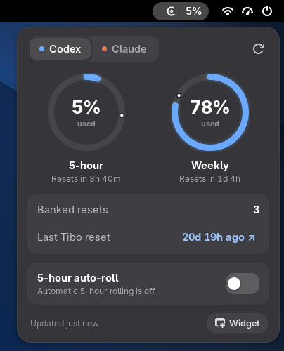
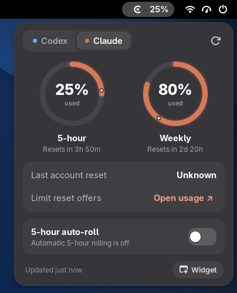
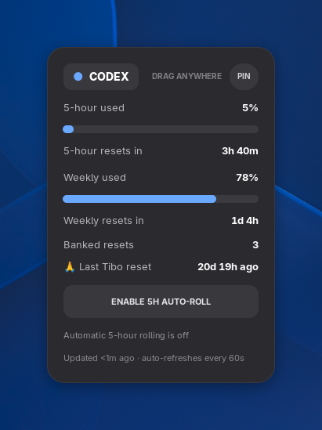
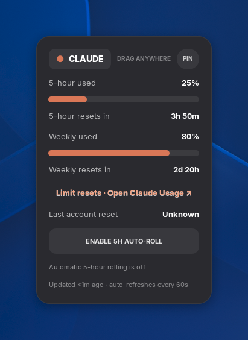
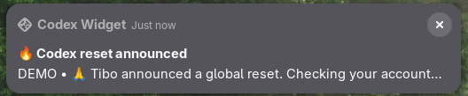
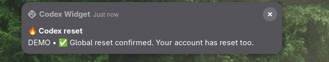
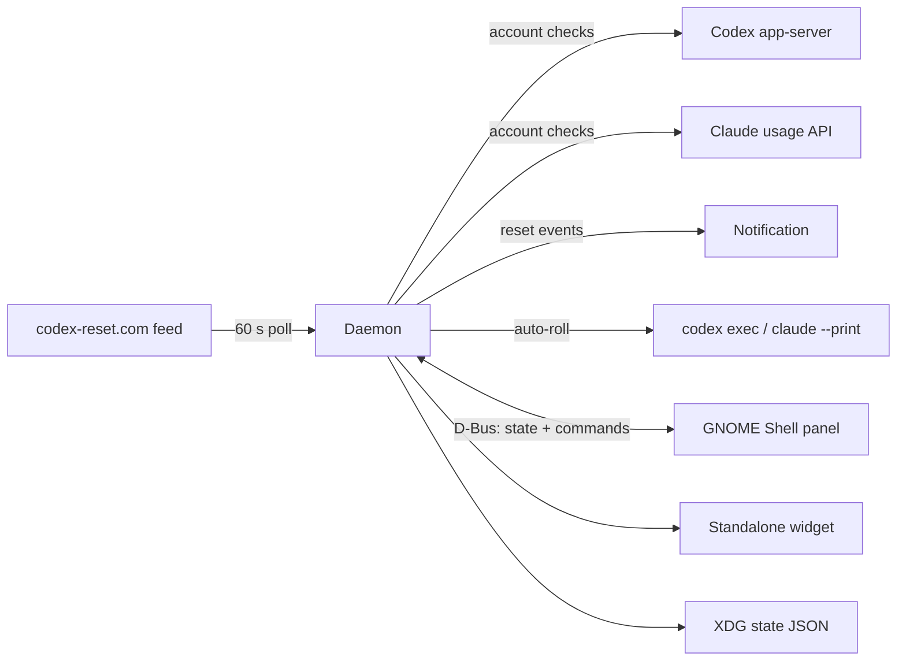

# Codex & Claude Usage for GNOME

Your Codex and Claude subscription limits, right in the GNOME top bar.

The icon shows how much of your current five-hour window you've used. Click it and a native panel drops down with usage rings, reset countdowns, reset history and the five-hour auto-roll switch, without opening a window.

<p align="center">
  
</p>

<table>
  <tr>
    <td align="center"><strong>Codex</strong></td>
    <td align="center"><strong>Claude</strong></td>
  </tr>
  <tr>
    <td></td>
    <td></td>
  </tr>
</table>

## Reading the panel

- **The top-bar percentage** is the selected provider's five-hour usage, so you can see it at a glance.
- **Each ring** fills with usage. It turns red at 90%.
- **The dot on each ring** marks how much of that window's time has passed. If the colored arc runs past the dot, you are using quota faster than the window is elapsing. If it stays behind, you have room.
- **The Codex / Claude switch** changes views in place. It appears once Claude Code is installed.
- **Refresh** forces a fresh read. Opening the panel also refreshes usage older than 20 seconds, and it keeps refreshing every minute while open.
- **Last Tibo reset** (Codex) links to the announcement. **Limit reset offers** (Claude) opens Claude's usage page.
- **5-hour auto-roll** turns automatic window activation on or off for the selected provider.
- **Widget** opens the standalone card (below).

## Features

- Real five-hour and weekly usage for Codex and Claude, with separate reset countdowns.
- Codex banked resets and Tibo's latest global reset, from a verified feed polled once a minute.
- Two-stage desktop notifications when a global Codex reset is announced and then confirmed on your account.
- Claude account-reset detection from observed usage drops, plus a link to Claude's limit-reset offers.
- Optional, independent five-hour auto-roll per provider, with persistent deadlines, retries and verification.
- Automatic Claude Code detection; the selected provider is remembered.
- A resident background service that starts with your session and keeps only minimal local state.
- A classic AppIndicator tray icon as a fallback. It hides itself automatically while the top-bar panel is running.

## Standalone widget

The original floating card is still available from the panel's **Widget** button, the application menu, or `codex-widget`. It has been restyled to match the panel.

<table>
  <tr>
    <td align="center"><strong>Codex</strong></td>
    <td align="center"><strong>Claude</strong></td>
  </tr>
  <tr>
    <td></td>
    <td></td>
  </tr>
</table>

Click the provider name to switch views, drag the card anywhere, and use **PIN** to keep it above other windows. An unpinned card hides when it loses focus; Escape always closes it.

## Notifications

Codex uses two-stage notifications: a global reset announcement, then a check of your own account.

<table>
  <tr>
    <td align="center"><strong>Codex reset announced</strong></td>
    <td align="center"><strong>Codex account checked</strong></td>
  </tr>
  <tr>
    <td></td>
    <td></td>
  </tr>
</table>

Claude reset notifications come from observed drops in your own account's usage, not an external feed. A first usage sample only seeds the observation; a notification needs a recent earlier sample with higher usage.

## Requirements

- Linux with Python 3.11 or newer
- GNOME Shell 48–51 for the top-bar panel (tested on 51)
- GTK 3 and PyGObject
- `notify-send` from libnotify
- An installed and authenticated `codex` CLI with app-server support
- Optional: Claude Code signed in with a Claude subscription (`claude auth login`) to enable the Claude view
- Optional, for the fallback tray icon: Ayatana AppIndicator and the GNOME AppIndicator extension

On Arch-based distributions the relevant packages are `python`, `python-gobject`, `gtk3`, `libayatana-appindicator` and `libnotify`.

## Install

```bash
git clone https://github.com/1RV1NG-Y/codex-reset-widget.git
cd codex-reset-widget
./install-user.sh
```

The installer:

- creates an isolated application environment under `~/.local/share/codex-widget`
- installs the launcher and icon
- installs and enables the `codex-widget@codex_widget.github.io` GNOME Shell extension
- enables and restarts the `codex-widget` user service

**Log out and back in once** after installing or updating. GNOME Shell on Wayland only loads new or changed extension code at login. Until then the tray icon keeps working.

To update:

```bash
git pull --ff-only
./install-user.sh
```

Manage the panel with `gnome-extensions enable|disable codex-widget@codex_widget.github.io`. The installed app does not depend on the cloned repository.

## Usage

```bash
codex-widget               # open the standalone widget
codex-widget --demo-reset  # preview the two-stage reset notification
codex-widget --daemon      # run silently in the background
codex-widget --quit        # stop the background app
```

Without the extension, the tray menu offers **Open Codex Widget**, **Check usage and resets now** and **Quit Codex Widget**.

### Five-hour auto-roll

Turn on **5-hour auto-roll** to keep a five-hour window active continuously. Each provider has its own persisted setting, and both start off.

When enabled, the background service reads your limits and schedules one tiny request ten seconds after the active five-hour window resets: an ephemeral, read-only `gpt-5.6-luna` request in Codex, or a tiny Haiku request in Claude with tools, MCP servers, settings and session persistence disabled. If no window is active, it activates one immediately.

A request finishing is not counted as success. Afterwards the service reads limits three times over 30 seconds, and only a future reset time that stays within three seconds is marked verified. This confirms an active countdown; it can't prove the widget was the only client using the account.

Each request consumes a little quota. Failed attempts retry after a minute, and every third failure triggers a five-hour cooldown. A full weekly quota pauses activation until the weekly reset. Deadlines, verification and failure counts survive restarts, and turning the switch off cancels the pending activation.

### Claude support

Install Claude Code and sign in with `claude auth login`. The app finds `claude` on `PATH` or in `~/.local/bin`, and supports `CLAUDE_CONFIG_DIR`.

It reads Claude's own OAuth usage endpoint for five-hour and weekly percentages and reset times. It reuses Claude Code's saved login and renews it when possible, without copying tokens into its own state. Usage is checked before renewing, so a stale local expiry timestamp doesn't interrupt a working token. Temporary failures report their HTTP status and retry; a rejected refresh token asks you to sign in again. HTTP rate limits pause Claude requests for five minutes. The usage endpoint is an internal Claude interface and may change.

Claude occasionally offers account-specific limit resets, redeemable on its Usage page. The usage API doesn't expose an offer count, so the panel links to that page instead of guessing. See [Claude's limit-reset documentation](https://support.claude.com/en/articles/17007452-what-is-a-limit-reset). Resets are never redeemed automatically.

## How it works



A single background service does all account access and scheduling. The GNOME Shell extension only draws the panel: it reads a cached snapshot from the service over D-Bus (`io.github.codex_widget.Panel1`), listens for change signals, and sends small commands back (refresh, switch provider, toggle auto-roll, open widget). Every call is asynchronous, so a busy service never stalls the shell. If the service stops, the panel shows a **Start service** button.

Data sources:

- `https://codex-reset.com/api/feed` says whether a Codex reset was publicly announced.
- `account/rateLimits/read` on the local Codex app-server reports what your account actually shows.
- `https://api.anthropic.com/api/oauth/usage` reports Claude's usage windows.

For npm-installed Codex on Linux, the service uses the native executable bundled with that installation, so usage reads and auto-roll keep working if a system update breaks the Node launcher.

## Background service and state

The `codex-widget` user service starts with your graphical session and owns the app's single instance. Launching from the menu starts it if needed.

```bash
systemctl --user status codex-widget.service
systemctl --user restart codex-widget.service
systemctl --user disable --now codex-widget.service
```

State lives under `${XDG_STATE_HOME:-~/.local/state}/codex-widget/` and is written atomically:

- `state.json`: Codex usage, reset history, auto-roll state and the selected view
- `claude-state.json`: Claude usage, observed resets and its own auto-roll state

## Resource usage

The service is one idle GTK/Python process. Codex CLI subprocesses run only for account checks and auto-roll requests. Network activity:

- one reset-feed request per minute, plus a fallback when needed
- Codex usage reads when the panel or widget opens, every minute while either is open, and every five minutes while the panel is installed (to keep the top-bar number current)
- Claude usage reads every five minutes in the background, and every minute while its view is open
- with auto-roll on, one tiny request per provider per five-hour window, plus bounded retries and verification reads

## Development

Run from the source tree without installing:

```bash
./launch-codex-widget.sh
```

Run the tests:

```bash
PYTHONPATH=src python3 -m unittest discover -s tests -v
```

The tests mock all account requests and never consume quota. The extension lives in [`gnome-extension/`](gnome-extension/); after changing it, rerun `./install-user.sh` and log back in.

See [CHANGELOG.md](CHANGELOG.md) for release notes.

## License

MIT
